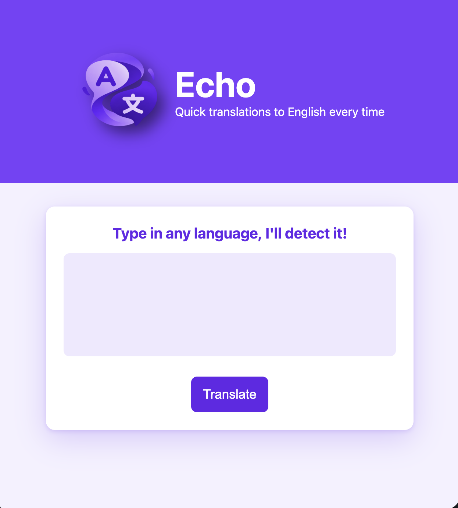
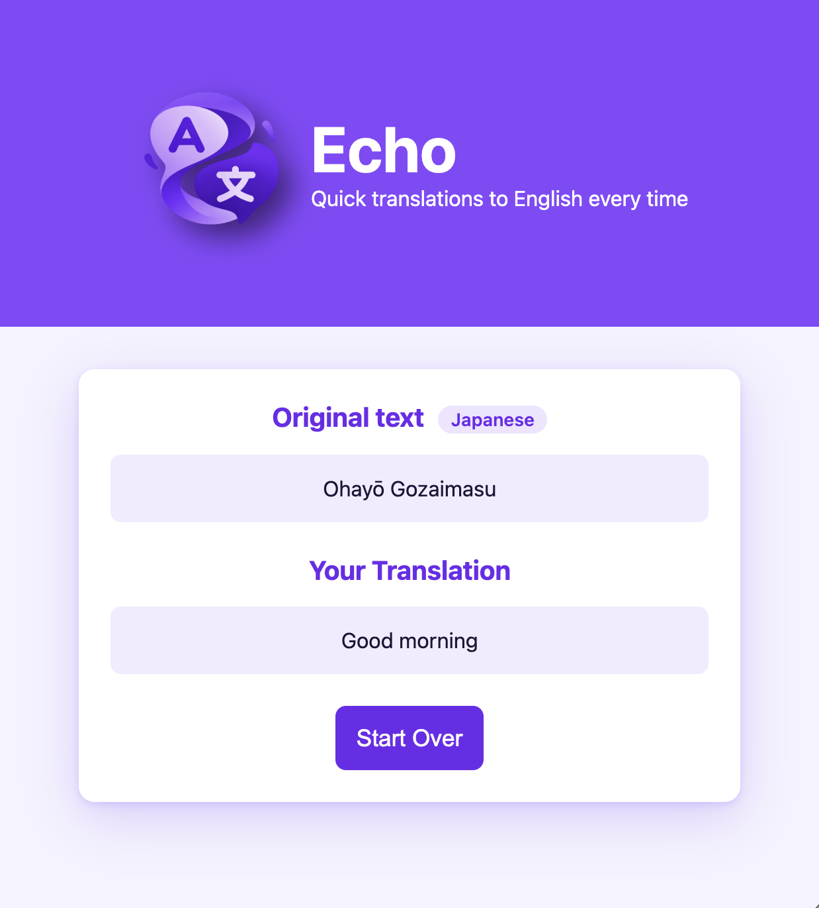

# Echo

A single-page translation app that auto-detects the language you type and translates it into English using the Claude API, built with vanilla HTML, CSS, and JavaScript.

  
  &nbsp;
  

## Features

- Type in any language and Echo detects it automatically, with no language picker needed
- Every translation comes back in English, powered by the Claude API
- The results screen shows your original text, the detected language, and the translation
- Press Enter to translate, or Shift + Enter to add a new line
- The Translate button shows a loading state and is disabled while a request is running
- Friendly error messages if the network or API fails, so the app never gets stuck
- Empty or spaces-only input is ignored, so no wasted requests
- A Start Over button resets the app for the next translation
- Responsive, mobile-first purple theme that works on phones, tablets, and desktops

## Built With

- **HTML5**
- **CSS3** — Flexbox layout, media queries, mobile-first responsive design
- **JavaScript** — DOM manipulation, the Fetch API, and `async` / `await`, `try` / `catch`
- **[Claude API](https://docs.claude.com)** — AI model that detects the language and translates the text

## Skills Showcased

- Sending `POST` requests with custom headers using the Fetch API
- Prompting an AI to reply in JSON and parsing it with `JSON.parse()`
- Handling errors with `try` / `catch` / `finally` and `res.ok` checks
- Using guard clauses to stop bad input early
- Listening for keyboard events with `keydown`, `e.key`, and `e.shiftKey`
- Switching between two views on a single page
- Keeping an API key out of version control with `.gitignore`

> **Note:** This project calls the Claude API directly from the browser after you configure your "config,js", which is fine for local use but exposes the key to anyone using the page. It isn't meant to be deployed publicly as is.
